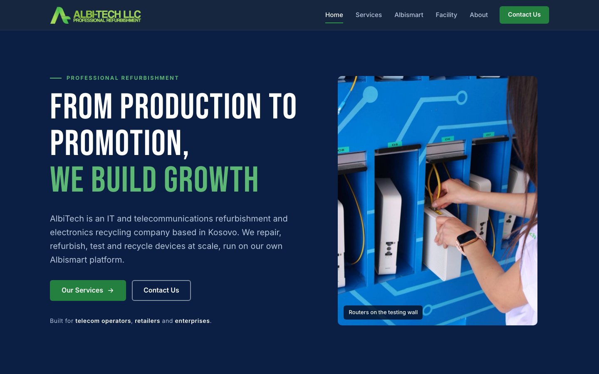
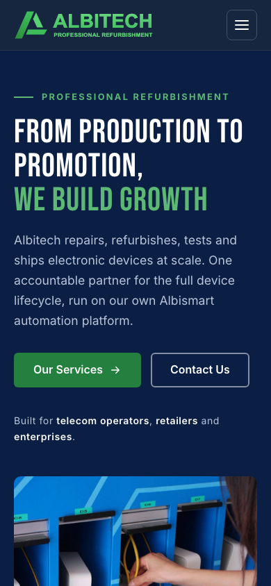
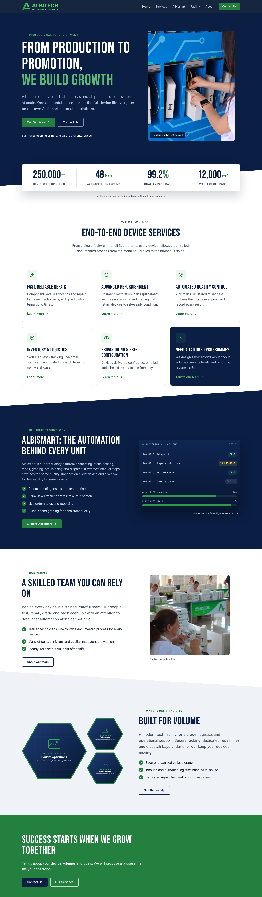

# Albitech website

Marketing website for **Albitech, Professional Refurbishment**: electronics repair, refurbishment, automated quality control, warehouse logistics and device provisioning, powered by the in-house Albismart automation platform.

The site is plain HTML, CSS and JavaScript. There is no build step and no dependencies apart from Google Fonts, so it runs on any static host.

**Live site:** https://erlisgashi67-commits.github.io/albitech-website/

## Screenshots



<p>
  
</p>

<details>
<summary>Full home page (desktop)</summary>



</details>

Some facility photos and the figures are still placeholders until real content is added.

## Pages

| Page | Contents |
| --- | --- |
| [`index.html`](index.html) | Hero, animated stats, services overview, Albismart highlight, facility preview, call to action |
| [`services.html`](services.html) | Detailed cards for the five services, industries served, engagement steps |
| [`albismart.html`](albismart.html) | The automation platform and its six-step process: Intake, Diagnostics, Repair, QC, Provisioning, Dispatch |
| [`facility.html`](facility.html) | Warehouse and facility, hexagon photo gallery, facility figures |
| [`about.html`](about.html) | Company story, mission, values, sustainability |
| [`contact.html`](contact.html) | Contact form, contact details, business hours, Google Map of the Kijevë warehouse |

## Features

- Responsive layout for mobile, tablet and desktop, with a sticky header and mobile menu
- Scroll animations (fade in and slide up), animated counters and an animated circuit-trace hero
- Accessibility: skip link, keyboard-friendly menu, visible focus, labelled form errors, AA colour contrast, and support for the reduced-motion setting
- SEO: unique titles and descriptions, canonical URLs, Open Graph and Twitter tags, structured data, `robots.txt` and `sitemap.xml`
- A contact form ready for [Formspree](https://formspree.io), falling back to the visitor's email app until it is connected

## Project structure

```
.
├── index.html, services.html, albismart.html, facility.html, about.html, contact.html
├── assets/
│   ├── css/styles.css        All styles; colours, fonts and spacing are variables at the top
│   ├── js/main.js            Menu, scroll reveal, counters, contact form
│   └── img/                  Logo, favicon, graphics, Open Graph image
│       ├── photos/           Real Albitech photos (metadata stripped)
│       └── placeholders/     Labelled stand-ins for photos still to come
├── robots.txt
└── sitemap.xml
```

The header and footer are repeated in each page. If you change a navigation link, change it in all six files.

## Run locally

```bash
python3 -m http.server 8080
```

Then open http://localhost:8080.

## Deployment (GitHub Pages)

The site is published from the `main` branch, root folder (**Settings → Pages**). Every push to `main` updates the live site within a minute or two.

All links are relative, so the site works both at the `github.io` address and on a custom domain.

### Custom domain

When the company domain is ready to point here:

1. In **Settings → Pages → Custom domain**, enter `www.albi-tech.net` and save. This adds a `CNAME` file to the repo.
2. At the DNS provider, create a `CNAME` record for `www` pointing to `<github-username>.github.io`. For the bare domain `albi-tech.net`, add `A` records to GitHub's Pages IP addresses (listed in GitHub's documentation, "Managing a custom domain for your GitHub Pages site").
3. Once DNS has updated, tick **Enforce HTTPS**.

Do step 1 only after DNS is ready. Otherwise the `github.io` address redirects to a domain that does not serve the site yet.

## Placeholders to replace before launch

Search the project for `PLACEHOLDER` to find every one.

**Photos** (`assets/img/placeholders/*.svg`). Each placeholder is labelled and names its suggested replacement. Use landscape photos of at least 1200 x 1040 px, with the subject centred, because the hexagon frames crop the corners. After swapping a `src`, update its `alt` text and remove the word "Placeholder".

| Placeholder | Used on | Suggested photo |
| --- | --- | --- |
| `warehouse-racking.svg` | Home, Facility | Pallet racking with stock |
| `forklift.svg` | Home, Facility | Forklift operator in an aisle |
| `pallet-handling.svg` | Home, Facility | Worker moving a wrapped pallet |
| `dispatch.svg` | Facility | Loading bay or outbound pallets |
| `building.svg` | Facility, About | Building exterior with signage |

**Figures.** The stats on the home and facility pages are examples. Update each `data-count` value and the matching `sr-only` sentence next to it, then delete the "Placeholder figures" note.

**Other content**
- `contact.html`: phone number and business hours (the warehouse address and map are done)
- Footer on every page: Instagram is linked; the LinkedIn and Facebook icons still point to `#`
- `about.html`: add the founding year, milestones and team details to the story
- `assets/img/logo.svg` is a simplified vector logo; replace it with the official file if one exists

## Photos and location

Real photos live in `assets/img/photos/`:

| File | Used on | Shows |
| --- | --- | --- |
| `testing-wall.jpg` | Home hero, Facility gallery, About story | A technician connecting a router on the blue testing wall |
| `production-line.jpg` | Home "Our people", About "Our team" | The team testing and packing devices on the production line |

Before adding a new photo, resize it for the web (about 1000 to 1600 px on the long side) and strip its metadata, which can contain GPS coordinates and camera details. On macOS, `sips -s format jpeg -s formatOptions 80 --resampleWidth 1200 in.jpg --out out.jpg` does both. `production-line.jpg` is only 414 px wide, so a larger original would look sharper.

The warehouse is **Albitech L.L.C Warehouse, Kijevë, Kosovo** ([Google Maps](https://maps.app.goo.gl/2U7qtQhpvTjWQRKJ6)). The contact page embeds the map directly; it needs no API key.

## Contact form

Until it is connected, the form validates input and then opens the visitor's email app, addressed to office@albi-tech.net.

To connect Formspree:

1. Create a form in Formspree with office@albi-tech.net as the recipient.
2. Put its endpoint in the form's `action` attribute in `contact.html`:

   ```html
   <form data-contact-form action="https://formspree.io/f/your-form-id" method="post" novalidate ...>
   ```

3. In Formspree, restrict the form to the site's domains (`albi-tech.net`, `www.albi-tech.net` and the `github.io` address) so other sites cannot post to it.
4. Send a test enquiry from the live site.

The site sends name, company, email, phone, service of interest, monthly volume, message, consent and a generated `_subject` line. A hidden `_gotcha` field catches spam bots.

## Open Graph image

`assets/img/og-image.png` (1200 x 630) is the preview image for links shared on social media. It is rendered from `assets/img/og-image.svg`; if you edit the SVG, export a new PNG at the same size.
