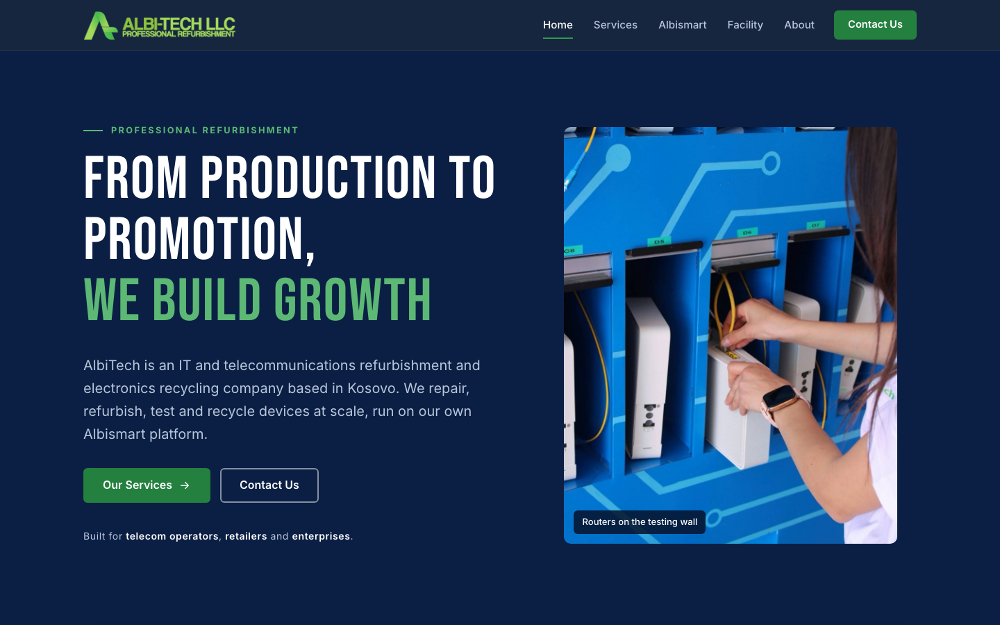
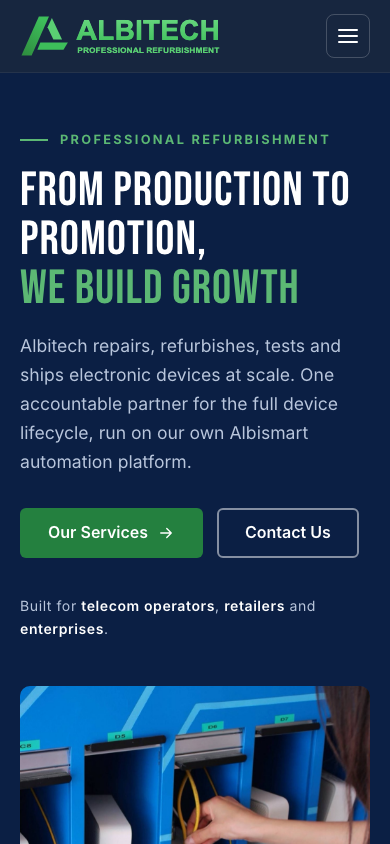
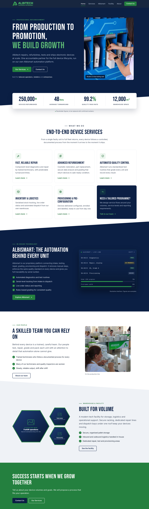

# Albitech website

Marketing website for **Albitech, Professional Refurbishment**: electronics repair, refurbishment, automated quality control, warehouse logistics and device provisioning, powered by the in-house Albismart automation platform.

The site is plain HTML, CSS and JavaScript. There is no build step and no dependencies apart from Google Fonts, so the public pages run on any static host. The optional admin panel in `admin/` needs PHP, which the cPanel hosting provides.

**Live site:** https://erlisgashi67-commits.github.io/albitech-website/

## Screenshots



<p>
  
</p>

<details>
<summary>Full home page (desktop)</summary>



</details>

## Pages

| Page | Contents |
| --- | --- |
| [`index.html`](index.html) | Hero, animated stats, services overview, Albismart highlight, facility preview, call to action |
| [`services.html`](services.html) | Detailed cards for the five services, industries served, engagement steps |
| [`albismart.html`](albismart.html) | The automation platform and its six-step process: Intake, Diagnostics, Repair, QC, Provisioning, Dispatch |
| [`facility.html`](facility.html) | Warehouse and facility, hexagon photo gallery, facility figures |
| [`about.html`](about.html) | Company story, mission, values, sustainability |
| [`contact.html`](contact.html) | Contact form, contact details, business hours, Google Map of the Kijevë warehouse |

## Features

- Responsive layout for mobile, tablet and desktop, with a sticky header and mobile menu
- Scroll animations (fade in and slide up), animated counters and an animated circuit-trace hero
- Accessibility: skip link, keyboard-friendly menu, visible focus, labelled form errors, AA colour contrast, and support for the reduced-motion setting
- SEO: unique titles and descriptions, canonical URLs, Open Graph and Twitter tags, structured data, `robots.txt` and `sitemap.xml`
- A contact form ready for [Formspree](https://formspree.io), falling back to the visitor's email app until it is connected

## Project structure

```
.
├── index.html, services.html, albismart.html, facility.html, about.html, contact.html
├── assets/
│   ├── css/styles.css        All styles; colours, fonts and spacing are variables at the top
│   ├── js/main.js            Menu, scroll reveal, counters, contact form
│   └── img/                  Official logo, favicon, Open Graph image
│       └── photos/           Real AlbiTech photos (resized, metadata stripped)
├── admin/                    Admin panel (PHP), see "Admin panel" below
├── data/content.json         Content the admin panel edits
├── robots.txt
└── sitemap.xml
```

The header and footer are repeated in each page. If you change a navigation link, change it in all six files. The footer's contact list is the exception: the admin panel writes it (see below).

## Admin panel

`/admin/` is a password-protected page for changing site content without editing HTML:

- **Numbers on the home page**: add, remove, reorder and edit the figures (CPE devices tested, countries reached and so on). Up to 8; more than 4 wrap to a second row.
- **Track record**: the heading, text and country tags beside the world map.
- **Address and contact**: street, building number, postal code, town, phone, email and map link. Used in every footer, on the Contact page, on About and in the structured data search engines read.
- **Business hours**: the Contact page table; the first row also appears in the footer.
- **History**: every save keeps the previous version (the last 30), and any of them can be restored.

It needs PHP 7.4 or newer, which cPanel hosting has. There is no database: the content is stored in `data/content.json`, and saving rewrites only the parts of the pages between `<!-- cms:name -->` and `<!-- /cms:name -->` markers. Everything else in the HTML is untouched, and the public site stays plain HTML.

```
admin/
├── index.php          Sign-in and the editor
├── lib.php            Checks the input and writes the pages (not reachable from the web)
├── build.php          Command line: apply data/content.json to the pages
├── set-password.php   Command line: set the admin password
└── admin.css, admin.js
data/
├── content.json       The editable content (committed)
├── .htaccess          Blocks web access to the whole folder
└── admin-credentials.php, backups/, login-attempts.json   Created on the server, not committed
```

### Setting it up on the server

1. On your computer, set the password: `php admin/set-password.php`. It writes `data/admin-credentials.php` with a hash of the password, never the password itself.
2. Upload the site as usual, including `admin/`, `data/` and `data/admin-credentials.php`.
3. Make sure PHP can write to `data/` and to the six `.html` files. On most cPanel hosts it already can; if a save reports a permission error, set the folder to 755 and the files to 644 in the cPanel File Manager.
4. Open `https://www.albi-tech.net/admin/` and sign in.

To change the password later, use **Change password** at the bottom of the admin page. Five wrong passwords lock sign-in from that address for 15 minutes. Sessions end after two hours without activity.

### Keeping the repository in step with the live site

Edits made in the admin exist only on the server. Before you upload a new version of the site from this repository, bring those edits back first, or the upload will overwrite them:

1. In the admin, click **Download a copy** and save it over `data/content.json`.
2. Run `php admin/build.php` to apply it to the pages, then commit.

When a page needs a new editable area, wrap it in a marker pair and add a matching case to `render_region()` in `admin/lib.php`.

### Testing locally

PHP's built-in server runs the admin (it ignores `.htaccess`, so `data/` is readable locally; on the server it is not):

```bash
php -S 127.0.0.1:8081 -t .
```

Then open http://127.0.0.1:8081/admin/.

## Run locally

```bash
python3 -m http.server 8080
```

Then open http://localhost:8080.

## Deployment (GitHub Pages)

The site is published from the `main` branch, root folder (**Settings → Pages**). Every push to `main` updates the live site within a minute or two.

All links are relative, so the site works both at the `github.io` address and on a custom domain.

### Custom domain

When the company domain is ready to point here:

1. In **Settings → Pages → Custom domain**, enter `www.albi-tech.net` and save. This adds a `CNAME` file to the repo.
2. At the DNS provider, create a `CNAME` record for `www` pointing to `<github-username>.github.io`. For the bare domain `albi-tech.net`, add `A` records to GitHub's Pages IP addresses (listed in GitHub's documentation, "Managing a custom domain for your GitHub Pages site").
3. Once DNS has updated, tick **Enforce HTTPS**.

Do step 1 only after DNS is ready. Otherwise the `github.io` address redirects to a domain that does not serve the site yet.

## Still to fill in

Search the project for `PLACEHOLDER` to find each one.

- `contact.html`: business hours.
- `assets/img/logo.png` is the official logo, but the source file is only 240 px wide. A larger PNG or an SVG would look sharper on high-resolution screens.

## Photos, content sources and location

All photos in `assets/img/photos/` are AlbiTech's own. They are resized for the web, and their metadata (GPS, camera, creator) is removed.

| File | Used on | Shows |
| --- | --- | --- |
| `testing-wall.jpg` | Home hero, Facility gallery | A technician connecting a router on the blue testing wall |
| `team-building.jpg` | Home "Our people" | The whole team in front of the AlbiTech building |
| `office-team.jpg` | About story | The team in front of an Albi Smart office building |
| `production-line.jpg` | About "Our team" | The team testing and packing devices (only 414 px wide) |
| `racking.jpg`, `pallets.jpg`, `device-racks.jpg` | Home, Facility | Warehouse racking, wrapped pallets, devices on test racks |
| `test-cabinet.jpg`, `test-touchscreen.jpg`, `test-wall-rack.jpg` | Albismart, Facility | Albismart testing racks and touchscreen |
| `packaging-kit.jpg`, `packaging-box.jpg` | Facility | Packed device kit and protective insert |
| `warehouse-exterior.jpg` | Facility | The warehouse building |
| `cpe-map.jpg` | Home "Track record" | Countries where AlbiTech CPE testing has been used |
| `stb-test-bench.jpg` | Albismart "Set-top boxes", Facility | Set-top box test bench with firmware updates on screen (cropped to remove a TV broadcast and other brands' boxes) |
| `test-cabling.jpg` | Facility | Network cables connected to routers in their test slots |
| `server-room.jpg` | Facility | Server and network racks in the server room |

Capabilities, test coverage and packaging options come from AlbiTech's own presentation material. The track record (10M CPE devices tested, 64 countries) and the full address (building 872, postal code 24060) came from the company in November 2026. `cpe-map.jpg` still marks the original ten countries. **Client-specific details are deliberately left out:** customer and partner names and logos, RFQ volumes, commercial terms, meeting participants, and software screenshots showing serial or MAC numbers. Keep them out when adding content.

Before adding a new photo, resize it and strip its metadata. On macOS: `sips -s format jpeg -s formatOptions 80 -Z 1400 in.jpg --out out.jpg`, then `sips --deleteProperty make --deleteProperty model out.jpg`. Check that it shows no other company's brand or readable serial numbers.

The warehouse is **AlbiTech L.L.C. Warehouse, Kijevë, Malishevë, Kosovo** ([Google Maps](https://maps.app.goo.gl/2U7qtQhpvTjWQRKJ6)). The contact page embeds the map directly; it needs no API key.

After changing `styles.css` or `main.js`, raise the `?v=` number in the links on every page so visitors get the new file straight away.

## Contact form

Until it is connected, the form validates input and then opens the visitor's email app, addressed to info@albi-tech.net.

To connect Formspree:

1. Create a form in Formspree with info@albi-tech.net as the recipient.
2. Put its endpoint in the form's `action` attribute in `contact.html`:

   ```html
   <form data-contact-form action="https://formspree.io/f/your-form-id" method="post" novalidate ...>
   ```

3. In Formspree, restrict the form to the site's domains (`albi-tech.net`, `www.albi-tech.net` and the `github.io` address) so other sites cannot post to it.
4. Send a test enquiry from the live site.

The site sends name, company, email, phone, service of interest, monthly volume, message, consent and a generated `_subject` line. A hidden `_gotcha` field catches spam bots.

## Open Graph image

`assets/img/og-image.png` (1200 x 630) is the preview image for links shared on social media. It is rendered from `assets/img/og-image.svg`; if you edit the SVG, export a new PNG at the same size.
